# Software Requirements Specification (SRS)

**IT342-G01 — Systems Integration and Architecture 1**

**Project title:** AJ Apartelle: A Web and Mobile Booking and Operations Management System with Calendar and SMS Integration
**Prepared by:** Maria Loraine L. Lobitana
**Date of submission:** November 5, 2026
**Version:** 1.3 (see [Revision history](#revision-history))

> This Markdown file is the **living copy** of the SRS. It is the source of truth for the project and must be kept in sync with the code. The submitted original is kept unchanged at [IT342_G01_Lobitana_MariaLoraine_AJApartelle_SRS.pdf](IT342_G01_Lobitana_MariaLoraine_AJApartelle_SRS.pdf). Diagrams are in [srs-figures/](srs-figures/).

---

## Revision history

| Version | Date | Author | Changes |
|---|---|---|---|
| 1.0 | 2026-11-05 | Maria Loraine L. Lobitana | Initial submitted SRS. |
| 1.0-md | 2026-11-15 | Maria Loraine L. Lobitana | Converted the PDF to this Markdown living copy; ERD tables transcribed from Figure 1. No requirement changes. |
| 1.1 | 2026-11-15 | Maria Loraine L. Lobitana | Added a Status column (Not started / In progress / Completed) to every functional requirement table (Sections 3.1–3.11) and to Table 5 (NFRs); legend added in Section 3. All FR-001–FR-062, FR-069, FR-070 and NFR-01–NFR-25 set to Not started. No requirement text changed. |
| 1.2 | 2026-11-15 | Maria Loraine L. Lobitana | Added NFR-26 (GitHub Actions CI/CD: build, test, lint, secret scan on every push and PR; merge blocked on failure; JAR/APK artifacts from `main`). Updated Table 3 (development tools) and Table 8 (Week 1) to reference it. Deployment to a hosting server is not covered yet. |
| 1.3 | 2026-11-25 | Maria Loraine L. Lobitana | Added FR-071 (email-and-password registration and sign-in with bcrypt hashes, Feature 8, Must Have); amended FR-041 wording so it no longer forbids passwords for non-Google accounts. Updated Table 4 (Must Have 47, total 71), Section 3 intro, Feature 8 description, Table 7 (UC-01), Appendix D (SO4), Appendix E (`/auth/register`, `/auth/login`, `/auth/logout`, `/auth/me`) and the USERS ERD table (`password_hash`); Figure 1 marked out of date. Status: FR-045, FR-062, FR-071 → Completed; FR-061 → In progress (email-and-password path done; Google path not built); FR-041, FR-042, FR-043 → In progress (Google sign-in not built yet); NFR-26 → In progress (backend, web and secret-scan CI jobs exist; mobile job not built yet). Fixed revision-history authors and the link to the submitted PDF. Reworded NFR-07 (web JWT only in an httpOnly, SameSite=Strict cookie, Secure over HTTPS, never in localStorage or sessionStorage; mobile token in Expo SecureStore) with a new verification method; NFR-07 → In progress (web verified; mobile not built). Allowed email-and-password accounts (FR-071) wherever a Google account was required: SO4, core feature 8 (Section 1.5), Section 1.6 limitations, A-02, A-03, FR-061 wording, and the glossary entries Step and JWT. Added REVOKED_TOKENS (jti PK, expires_at; server-side sign-out, FR-046) to the ERD tables, Section 5.1 text, Table 6 note and Appendix D (SO4); Figure 1 still out of date. NFR-17, NFR-18 → Completed; FR-044 and FR-046 left Not started (only partly covered until all Appendix F capabilities and the mobile app exist). Reworded the NFR-26 trigger to every push to `main` and every pull request, to match the CI workflow (status unchanged). Aligned the remaining sign-in and token wording with FR-071 and NFR-07: Section 1.6 (Testing-mode limitation), Table 2 (Guest), D-01, Feature 2 description, Table 7 (UC-01 name), Figure 8 key points, Appendix B summary and Appendix E (web cookie, planned mobile Bearer header, open item for the backend filter); Figures 2, 3, 4, 5, 6, 8 and 9 marked out of date (no status changed). Added `mobile_number` (nullable, 09XXXXXXXXX) to the USERS ERD table to match migration V1. Set the primary key of the ten Figure 1 tables to `id` in the ERD tables and stated the key convention with its exceptions (REVOKED_TOKENS `jti`; seven descriptive foreign key names; no foreign key renamed). USERS: added `updated_at`, marked `google_sub` and `photo_url` as planned with FR-041, and noted that the same future migration makes `password_hash` nullable with a CHECK that non-staff users have a password or google_sub (V1 unchanged). Corrected the Figure 1 out-of-date note. Defined linking of a Google sign-in to an existing account by verified email, keeping the role (self-registered GUEST: password cleared and tokens invalidated; STAFF and OWNER: password kept; 409 for a different google_sub): FR-041, FR-043, Feature 8 description, Table 7 (UC-01), Figure 8 note and key points, Appendix E (`/auth/google`). PAYMENTS: added `voided_at`, `voided_by` and `void_reason` with a CHECK and audit note (FR-029, NFR-08); removed `voided` (voided_at IS NOT NULL means voided); updated Table 6 and the Figure 1 and 6 notes. Added USERS `token_version` (built in migration V2; FR-041 linking will use it to invalidate tokens), the FR-041 note on sign-in with a null password hash, the owner void endpoint (Appendix E) and voiding as an alternate flow of UC-12. Increment 2 (User Profile and Password Management): added FR-072 (view and edit own profile), FR-073 (change password), FR-074 (forgot password) and FR-075 (reset password), all Must Have, with UC-24, UC-25 and UC-26; updated Table 4 (Must Have 51, total 75), the Section 3 intro, core feature 8 (Section 1.5), the Feature 8 description, Table 7 and Appendices B, D, E and F; amended FR-045 so deactivation also increments `token_version`; added the PASSWORD_RESET_TOKENS table (migration V2) to the ERD tables and Table 6; added Gmail SMTP for password reset emails (Section 1.5, Table 1, Table 3, D-08) and its app password to NFR-06; extended the Appendix E error format (field errors, 405, 415, 500); marked Figures 1, 2, 3, 6 and 9 out of date for these additions. Status after verification: FR-072, FR-073, FR-074 and FR-075 → Completed; FR-045 re-verified with the amended wording and remains Completed. Added the password length rule (at least 8 characters, at most 72 UTF-8 bytes) to FR-071, FR-073 and FR-075; already implemented and tested, statuses unchanged. |

<!-- Add a row for every change: bump the version (1.1, 1.2, …), list the IDs added/changed/removed. -->

---

## Table of contents

1. [Introduction](#1-introduction)
2. [Overall Description](#2-overall-description)
3. [System Features and Functional Requirements](#3-system-features-and-functional-requirements)
4. [Non-Functional Requirements](#4-non-functional-requirements)
5. [System Models (Diagrams)](#5-system-models-diagrams)
6. [Initial Project Timeline](#6-initial-project-timeline)
7. [References](#7-references)
8. [Appendices](#8-appendices)

---

## 1. Introduction

### 1.1. Project Title

AJ Apartelle: A Web and Mobile Booking and Operations Management System with Calendar and SMS Integration

### 1.2. Project Background

AJ Apartelle is a small, family-run apartelle that rents furnished rooms to guests for short and extended stays. The owner manages the business, often remotely, and keeps the booking, income, and expense records. Front-desk staff run day-to-day operations: they answer calls and messages from guests, receive arriving guests, check them in and out, collect payments in cash or by GCash, prepare rooms, and pay for daily supplies and repairs.

The apartelle already has a simple booking and expense application, but it is maintained by the owner. Its options are scattered across screens and it has no clear workflow, so staff who are not comfortable with technology avoid using it and report to the owner only from time to time. Guests, meanwhile, can book only by calling or sending a message, and they receive no formal confirmation or reminder.

**Guide questions**

- **What is the current problem or difficulty?** Booking, payment, and expense records are updated late or not at all because staff do not use the current application and do not consistently report check-ins, payments, and expenses. Room availability and financial figures therefore drift away from reality, which risks double bookings and inaccurate financial monitoring. Guests have no self-service way to check availability or book, and no confirmation or reminder, which leads to miscommunication and no-shows.
- **Who experiences this problem?** The owner, who cannot rely on the data to make decisions; the front-desk staff, who find the current system hard to use; and the guests, who lack a convenient and reliable way to book.
- **Why is a software system needed?** Only a shared, always-available system can make the front desk the place where data is recorded at the moment things happen. A guided interface lets non-technical staff record bookings, room status, payments, and expenses in a few taps; a database rule makes double bookings impossible; and integrations with Google sign-in, Google Calendar, and SMS deliver accurate information to the owner, staff, and guests automatically instead of relying on people to relay it.

### 1.3. Problem Statement

The owner of AJ Apartelle currently maintains the booking and expense records, while the front-desk staff handle day-to-day operations. Because staff do not consistently report walk-in bookings, check-ins, payments, and expenses, the owner's records quickly become outdated. Room availability, income, and expense figures may not reflect what is actually happening in the apartelle, which risks double bookings and inaccurate financial monitoring.

The existing booking application also has scattered options and no clear workflow, so staff who are not tech-savvy avoid using it. Meanwhile, guests have no direct way to check availability or book online. They must call or message the apartelle and receive no formal confirmation or reminder, which leads to miscommunication and no-shows.

**Main problem:** AJ Apartelle has no single, easy-to-use system through which guests, staff, and the owner record and receive accurate booking and financial information at the time it happens.

### 1.4. Project Objectives

**General Objective**

To develop a web and mobile booking and operations management system for AJ Apartelle that lets guests request bookings online, enables non-technical staff to record bookings, room status, payments, and expenses as they happen, and integrates Google OAuth 2.0, the Google Calendar API, and the Semaphore SMS API so that the owner, staff, and guests receive accurate and timely booking information. The target is that every booking, payment, and expense handled at the apartelle is recorded in the system on the day it happens.

**Specific Objectives**

1. **(SO1)** To implement a guest booking module in which a signed-in guest can view real-time room availability and submit a booking request in no more than three steps (select room and dates; enter guest details and mobile number; review and submit), while automatically rejecting any request that overlaps a pending or confirmed booking for the same room. Each request is saved as Pending until staff confirm or decline it; a request not acted on within 24 hours, or by the check-in date if that comes first, is automatically declined. Guests can also view their bookings and cancel a booking before its check-in date.
2. **(SO2)** To develop a staff interface organized as a guided daily workflow (pending requests, arrivals, in-house guests, departures) in which confirming or declining a booking request, recording a walk-in or phone booking, changing a booking's dates or room, cancelling a booking, check-in, check-out, updating room status (available, occupied, cleaning), recording a payment, and entering an expense can each be completed in no more than three actions.
3. **(SO3)** To develop an owner dashboard that shows current occupancy, income, and expenses, including every transaction recorded by staff up to the moment the dashboard loads, and generates a monthly summary report of bookings, income, and expenses.
4. **(SO4)** To integrate Google OAuth 2.0 so that guests, staff, and the owner can sign in using Google accounts (or with an email address and password, FR-071) and can access only the features permitted by their assigned role.
5. **(SO5)** To integrate the Google Calendar API so that every booking that is confirmed, modified, or cancelled is reflected on the apartelle's shared booking calendar within one minute, with each event holding only the minimum details staff need.
6. **(SO6)** To integrate the Semaphore SMS API to send the guest a booking confirmation within one minute after staff confirm the booking, a decline notice within one minute after a request is declined, a check-in reminder one day before the scheduled arrival for bookings confirmed at least one day ahead, and a cancellation notice within one minute after a booking is cancelled.

Terms such as "real-time availability", "step", "action", "Pending", "Confirmed", and "within one minute" are defined in [Appendix A](#81-appendix-a-glossary-and-definitions).

### 1.5. Scope of the Project

**Platforms.** A ReactJS web application used by guests (view rooms and request bookings) and by the owner (dashboard, reports, setup); a React Native mobile application for Android used by guests and by front-desk staff for daily operations. Both use the same Spring Boot REST API and PostgreSQL database, so data stays consistent across platforms.

**Users covered.** Guests, front-desk staff, and the owner (administrator). Walk-in and phone guests do not need an account: staff record their booking, including their mobile number for SMS notices.

**Core features (11):**

1. Room listing with rates, details, and a real-time availability calendar
2. Online booking requests with automatic prevention of overlapping bookings and automatic decline of requests not acted on within 24 hours
3. Staff confirmation or decline of pending online booking requests, recording of walk-in and phone bookings, changing and cancelling of bookings by staff, and cancellation by guests before the check-in date
4. Guided staff workflow for arrivals, check-in, check-out, and room status (available, occupied, cleaning)
5. Manual recording of payments received at the front desk (cash or GCash transfer) and marking of bookings as paid
6. Daily expense recording by staff with categories
7. Owner dashboard for occupancy, income, and expenses, with monthly summary reports
8. Role-based access for guests, staff, and owner using Google sign-in or an email address and password (FR-071), with self-service profile and password management (FR-072 to FR-075)
9. Automatic synchronization of confirmed bookings to the shared Google Calendar
10. SMS booking confirmations, decline notices, check-in reminders, and cancellation notices
11. Owner management of rooms, room rates, and staff accounts (add, edit, deactivate)

**External systems.** Google OAuth 2.0 (sign-in), Google Calendar API (shared booking calendar), Semaphore SMS API (text messages to guests), and Gmail SMTP (password reset emails, FR-074). The database, backend, web frontend, and mobile frontend form the base of the system and are not counted as external systems.

### 1.6. Limitations of the Project

- No online payment through a payment gateway; payments are received at the front desk in cash or GCash and recorded manually. Refunds are not processed in the system.
- No integration with online travel platforms such as Agoda, Booking.com, or Airbnb, so bookings made there must be entered by staff as phone bookings.
- No payroll, utility billing, supply inventory, or tax and BIR reporting.
- One property only; multiple branches are not supported.
- Android only. The mobile application is distributed as an installation file (APK); there is no iOS version and no Play Store or App Store listing.
- Online guests must have a Google account or an email address and password (FR-071) to sign in and book. Guests without an account can still book by phone or walk-in.
- An internet connection is required for most actions. Only the staff mobile app tolerates short outages: it queues payment and expense entries and shows the last loaded screens read-only (FR-069, FR-070). Bookings, confirmations, check-ins, and check-outs need a connection so the overlap rule and room status stay correct.
- SMS delivery depends on Semaphore and the mobile networks, and each message uses a paid credit (about PHP 0.56 per 160-character message).
- While the Google OAuth consent screen is in Testing mode, only listed test accounts can sign in with Google (email-and-password sign-in under FR-071 is not affected); the app must be published before public use.

---

## 2. Overall Description

### 2.1. Product Perspective

AJ Apartelle Booking and Operations Management System is a new, multi-platform system: a ReactJS web application and a React Native Android application, both served by one Spring Boot REST API and one PostgreSQL database. It replaces the owner-maintained booking application and the current practice of booking by phone call or message.

The system follows a **client-server architecture**. Inside the backend it uses a **layered design** (controllers, services, repositories) organized as a **modular monolith**, and it uses **event-driven handling** for the external integrations: booking changes write records to an outbox table, and a background worker sends them to Google Calendar and Semaphore and retries failures, so an outage of an external service never blocks or loses a booking. The architecture diagram is in [Appendix B](#82-appendix-b-system-architecture-diagram).

**Table 1. External interfaces of the system**

| Interface | Type | Data exchanged | Direction |
|---|---|---|---|
| Web and mobile apps to backend | REST/JSON over HTTPS, JWT | Rooms, bookings, payments, expenses, reports | Two-way |
| Google OAuth 2.0 | OpenID Connect / OAuth 2.0 | Google ID token: name, email, photo, Google account ID | Google to system |
| Google Calendar API | REST, service account | Event: room, guest first name and last initial, dates, reference | System to Google |
| Semaphore SMS API | REST (HTTPS POST) | Mobile number, message text; message ID and status back | System to Semaphore |
| Gmail SMTP | SMTP with STARTTLS (port 587) | Email address, first name, password reset link | System to Gmail |
| PostgreSQL | JDBC (Spring Data JPA) | All system data, outbox, audit log | Two-way |

### 2.2. User and Characteristics

**Table 2. Users and their characteristics**

| User | Characteristics | Platform | Main tasks |
|---|---|---|---|
| Guest | Members of the public of any age; familiar with smartphones and with signing in by Google account or by email and password (FR-071); may book once or occasionally; often reads SMS rather than email. | Web, Android | View rooms and availability, request bookings, view and cancel own bookings |
| Front-desk Staff | Non-technical employees; use a smartphone daily for calls and messaging but avoid complex applications; work in shifts and are often interrupted by guests. | Android (primary) | Confirm or decline requests, record walk-ins, check in and out, update room status, record payments and expenses |
| Owner (Administrator) | Business owner; comfortable with web applications; often away from the property and needs accurate figures remotely. | Web (primary), Android | Monitor dashboard and reports, manage rooms, rates, staff accounts, review activity log; can also do any staff task |
| Scheduler (time) | Not a person: the system clock that triggers automatic jobs. | Backend | Expire unanswered requests, send check-in reminders, retry failed calendar and SMS updates |

### 2.3. Operating Environment

**Table 3. Operating environment**

| Component | Requirement |
|---|---|
| Mobile client | Android 8.0 (API level 26) or later, 2 GB RAM or more, screen 5.0 to 6.7 inches, Wi-Fi or mobile data. Built with React Native (Expo), installed from an APK file; uses on-device storage for the offline payment and expense queue. |
| Web client | Latest two versions of Google Chrome, Microsoft Edge, Mozilla Firefox, or Safari on a desktop, laptop, tablet, or phone (screen width 360 px or more). |
| Backend server | Java 21 (JDK), Spring Boot 3 (Spring Web, Spring Data JPA, Spring Security, Validation); at least 1 vCPU and 1 GB RAM; HTTPS endpoint. |
| Database | PostgreSQL 16 with the btree_gist extension; Docker container for development; Supabase free tier (used as plain PostgreSQL) for the shared demo database; schema managed by Flyway. |
| External services | Google Cloud project with OAuth 2.0 client IDs (web and Android) and the Google Calendar API enabled with a service account; Semaphore account with prepaid credits and an approved sender name; Gmail account with an app password for SMTP. |
| Development tools | IntelliJ IDEA or VS Code, Android Studio emulator, Node.js LTS, Git and GitHub with GitHub Actions for CI/CD (NFR-26), Swagger UI (springdoc-openapi), Postman, Figma for UI prototypes, JUnit 5 and Mockito for testing. |

### 2.4. Assumptions and Dependencies

**Assumptions**

- **A-01** Front-desk staff have an Android phone (Android 8.0 or later) with internet access at the front desk.
- **A-02** The owner and every staff member have a Google account or an email address and password (FR-071).
- **A-03** Online guests have a Google account or an email address and password (FR-071); walk-in and phone guests do not need an account.
- **A-04** Guests provide a valid Philippine mobile number in the format 09XXXXXXXXX.
- **A-05** Payments are received only at the front desk in cash or by GCash transfer, and staff record them on the same day.
- **A-06** The system serves one property with fewer than 50 rooms.
- **A-07** The apartelle has a Google account that owns the shared booking calendar, and staff can view that calendar on their phones.

**Dependencies**

- **D-01** Google OAuth 2.0 / Google Identity Services must be available, and the OAuth consent screen and client IDs must be configured, for Google sign-in; email-and-password sign-in (FR-071) does not depend on them.
- **D-02** The Google Calendar API must be enabled, and the service account must have permission to make changes to the shared calendar.
- **D-03** A Semaphore account with enough prepaid credits and an approved sender name (approval can take up to 5 business days) is required before any SMS can be sent.
- **D-04** SMS delivery depends on the Philippine mobile networks (Globe, Smart, DITO), which are outside the system's control.
- **D-05** The shared database uses the Supabase free tier, which pauses a project after a period without incoming requests. No keep-alive (heartbeat) is used; if the project has been paused, it is resumed from the Supabase dashboard before each laboratory session or demo, which takes a few minutes. Data is kept while a project is paused.
- **D-06** The system depends on open-source frameworks: Spring Boot, ReactJS, React Native (Expo), and PostgreSQL.
- **D-07** During development the backend runs only during laboratory sessions; for the pilot and the final demo it runs continuously. Scheduled jobs (request expiry, check-in reminders, calendar and SMS retries) run only while the backend is on, and on startup they immediately process anything that became due while it was off.
- **D-08** Gmail SMTP (free) must be reachable, and a Gmail app password must be configured, for password reset emails (FR-074). These emails are sent in the background after the token is saved and do not use the outbox, because the outbox would have to store the raw token; if sending fails, the user requests a new link. Sign-in, profile and change password do not depend on it.

---

## 3. System Features and Functional Requirements

This section describes the eleven major features of the system and their functional requirements. Every requirement has a unique identifier (FR-001 to FR-075; FR-069 and FR-070 were added to Feature 4 after the initial numbering, and FR-071 to FR-075 were added to Feature 8 in v1.3) and a priority using the MoSCoW method:

- **Must Have:** essential functionality; the system is not acceptable without it.
- **Should Have:** important but not critical; included if time allows within the schedule.
- **Could Have:** optional; included only after all Must and Should requirements are done.
- **Won't Have:** excluded from the current development scope (Section 3.12).

**Status** (last column of each requirement table, also used in Table 5) tracks implementation progress:

- **Not started:** no work done yet.
- **In progress:** partly built, or built but not yet verified.
- **Completed:** fully implemented and verified (tested or walked through against the requirement text). Optionally followed by the version that completed it, for example *Completed (v1.3)*.

**Table 4. Functional requirements by MoSCoW priority**

| Priority | Count |
|---|---|
| Must Have | 51 |
| Should Have | 13 |
| Could Have | 5 |
| Won't Have | 6 |
| **Total** | **75** |

### 3.1. Feature 1: Room Listing and Availability

**Description:** Shows every active room with its type, capacity, and nightly rate, and lets anyone check which rooms are free for a chosen date range. Availability is computed from all pending, confirmed, and checked-in bookings at the moment the page or screen loads. Supports SO1. Use cases: UC-02, UC-21.

| ID | Requirement | Priority | Status |
|---|---|---|---|
| FR-001 | The system shall display all active rooms with room number, room type, capacity, nightly rate (PHP), and description to any visitor, whether signed in or not. | Must Have | Not started |
| FR-002 | The system shall allow a user to enter a check-in and check-out date and shall list only rooms that have no PENDING, CONFIRMED, or CHECKED_IN booking overlapping those dates. | Must Have | Not started |
| FR-003 | The system shall reject a date range where the check-out date is not later than the check-in date, or where the check-in date is earlier than the current date (Asia/Manila time), and shall show an error message. | Must Have | Not started |
| FR-004 | The system shall show a monthly availability calendar for each room that marks the dates already booked. | Should Have | Not started |
| FR-005 | The system shall calculate and display the total price (number of nights multiplied by the nightly rate) before the guest submits a booking request. | Should Have | Not started |

### 3.2. Feature 2: Online Booking Requests

**Description:** Lets a guest who signed in (with Google or with email and password) request a room online, follow the status of the request, and cancel it. Online requests stay Pending until staff confirm or decline them, and unanswered requests expire automatically. Supports SO1. Use cases: UC-03, UC-04, UC-05, UC-19, UC-21.

| ID | Requirement | Priority | Status |
|---|---|---|---|
| FR-006 | The system shall allow a signed-in guest to submit a booking request in no more than three steps after sign-in: (1) select room and dates, (2) enter guest details and mobile number, (3) review and submit. | Must Have | Not started |
| FR-007 | The system shall require the guest's full name and a Philippine mobile number in the format 09XXXXXXXXX (11 digits) and shall reject any other format with an error message. | Must Have | Not started |
| FR-008 | The system shall save each online request with status PENDING, a unique booking reference (format AJ-YYMM-NNNN), and an expiry time equal to 24 hours after submission or the start of the check-in date, whichever comes first. | Must Have | Not started |
| FR-009 | The system shall prevent, at the database level, any two PENDING, CONFIRMED, or CHECKED_IN bookings for the same room from having overlapping dates; when a conflict occurs, nothing is saved and the user is told the room is no longer available. | Must Have | Not started |
| FR-010 | The system shall change every PENDING booking whose expiry time has passed to EXPIRED within 15 minutes and shall queue a decline SMS to the guest. | Must Have | Not started |
| FR-011 | The system shall allow a guest to view a list of his or her own bookings showing reference, room, dates, status, total amount, and amount paid. | Must Have | Not started |
| FR-012 | The system shall allow a guest to cancel his or her own PENDING or CONFIRMED booking before the check-in date, changing its status to CANCELLED. | Must Have | Not started |
| FR-013 | The system shall allow a guest to add an optional note of up to 250 characters to a booking request (for example, estimated arrival time). | Could Have | Not started |

### 3.3. Feature 3: Booking Management by Staff

**Description:** Gives front-desk staff one place to confirm or decline online requests, record walk-in and phone bookings, and change or cancel bookings. Supports SO2. Use cases: UC-05, UC-06, UC-07, UC-08.

| ID | Requirement | Priority | Status |
|---|---|---|---|
| FR-014 | The system shall list all PENDING requests on the staff Today screen, oldest first, showing guest name, room, dates, and the time left before the request expires. | Must Have | Not started |
| FR-015 | The system shall allow staff to confirm a pending request with one action, changing its status to CONFIRMED and recording the staff member and time. | Must Have | Not started |
| FR-016 | The system shall allow staff to decline a pending request with one action and an optional reason, changing its status to DECLINED. | Must Have | Not started |
| FR-017 | The system shall allow staff to record a walk-in or phone booking on one form (source, room, dates, guest name, mobile number), saved directly as CONFIRMED and subject to the same overlap rule as FR-009. | Must Have | Not started |
| FR-018 | The system shall allow staff to change the dates or room of a CONFIRMED booking, re-checking the overlap rule and recalculating the total amount. | Must Have | Not started |
| FR-019 | The system shall allow staff to cancel any PENDING or CONFIRMED booking with a reason, changing its status to CANCELLED. | Must Have | Not started |
| FR-020 | The system shall allow staff to search bookings by reference, guest name, or mobile number. | Should Have | Not started |

### 3.4. Feature 4: Guided Daily Workflow and Room Status

**Description:** Organizes the staff app as a daily checklist so non-technical staff always know what to do next: pending requests, arrivals, in-house guests, and departures. Supports SO2. Use cases: UC-09, UC-10, UC-11.

| ID | Requirement | Priority | Status |
|---|---|---|---|
| FR-021 | The system shall show staff a Today screen with four sections (Pending requests, Arrivals today, In-house guests, Departures today), each showing a count of items. | Must Have | Not started |
| FR-022 | The system shall allow staff to check in a CONFIRMED booking on or after its check-in date in no more than three actions, changing the booking to CHECKED_IN and the room to OCCUPIED. | Must Have | Not started |
| FR-023 | The system shall allow staff to check out a CHECKED_IN booking in no more than three actions, changing the booking to CHECKED_OUT and the room to CLEANING. | Must Have | Not started |
| FR-024 | The system shall warn staff before check-out when the booking still has an unpaid balance and shall let staff record the payment or continue after confirming. | Must Have | Not started |
| FR-025 | The system shall allow staff to set a room's status to AVAILABLE, OCCUPIED, or CLEANING in no more than three actions. | Must Have | Not started |
| FR-026 | The system shall show a room status board listing every active room, color-coded by status. | Should Have | Not started |
| FR-069 | When the staff mobile app loses its internet connection, it shall save new payment and expense entries in an on-device queue, mark them "Waiting to sync", and send them automatically and in order when the connection returns; each entry carries a unique client request ID so the server saves it only once. | Should Have | Not started |
| FR-070 | While offline, the staff mobile app shall show the last loaded Today screen and room list as read-only with an "Offline" banner and the time of the last update, and shall disable actions that need the server (confirm, decline, walk-in, change, cancel, check-in, check-out, room status) until the connection returns. | Should Have | Not started |

### 3.5. Feature 5: Payment Recording

**Description:** Records payments received at the front desk in cash or by GCash transfer and keeps each booking's balance and paid status current. There is no online payment gateway. Supports SO2. Use case: UC-12.

| ID | Requirement | Priority | Status |
|---|---|---|---|
| FR-027 | The system shall allow staff to record a payment for a booking with an amount greater than zero, a method of CASH or GCASH, and a GCash reference number when the method is GCASH; the staff member and time are saved automatically. | Must Have | Not started |
| FR-028 | The system shall compute each booking's balance as the total amount minus all valid payments and shall mark the booking as paid when the balance is zero or less. | Must Have | Not started |
| FR-029 | The system shall not allow payments to be deleted; only the owner may void a payment by giving a reason, and a voided payment stays visible but is excluded from totals. | Should Have | Not started |
| FR-030 | The system shall generate a printable payment receipt (PDF) showing booking reference, amount, method, and date. | Could Have | Not started |

### 3.6. Feature 6: Expense Recording

**Description:** Lets staff record the apartelle's daily expenses by category so the owner sees spending the same day it happens. Supports SO2. Use cases: UC-13, UC-16.

| ID | Requirement | Priority | Status |
|---|---|---|---|
| FR-031 | The system shall allow staff to record an expense with a category, an amount greater than zero, a short description, and an expense date (default: today) in no more than three actions. | Must Have | Not started |
| FR-032 | The system shall show staff the list of today's expenses and their total. | Must Have | Not started |
| FR-033 | The system shall allow the owner to add, rename, and deactivate expense categories; deactivated categories are hidden from new entries but kept on old ones. | Should Have | Not started |
| FR-034 | The system shall allow staff to attach one photo of the receipt (JPEG or PNG, up to 5 MB) to an expense. | Could Have | Not started |

### 3.7. Feature 7: Owner Dashboard and Reports

**Description:** Gives the owner a remote, up-to-date view of occupancy, income, and expenses, plus monthly summaries and a record of who entered what. Supports SO3. Use cases: UC-14, UC-15, UC-18.

| ID | Requirement | Priority | Status |
|---|---|---|---|
| FR-035 | The system shall show the owner a dashboard with rooms occupied versus total rooms, today's income (sum of today's payments), today's expenses, and the number of pending requests, including every transaction saved up to the moment the dashboard loads. | Must Have | Not started |
| FR-036 | The system shall generate a monthly summary for a selected month showing bookings by status and source, nights sold, occupancy rate (%), income by payment method, expenses by category, and net income. | Must Have | Not started |
| FR-037 | The system shall show a chart of daily income and expenses for the last 30 days. | Should Have | Not started |
| FR-038 | The system shall show the owner an activity log of every create and update on bookings, payments, and expenses, with the staff member, date and time, and old and new values, filterable by date range and staff member. | Should Have | Not started |
| FR-039 | The system shall show the owner a sync status page listing Google Calendar and SMS updates with their status (PENDING, SENT, FAILED) and number of attempts. | Should Have | Not started |
| FR-040 | The system shall export the monthly summary as a PDF file. | Could Have | Not started |

### 3.8. Feature 8: Google Sign-In and Role-Based Access

**Description:** Guests, staff, and the owner sign in with their Google accounts through Google OAuth 2.0, or with an email address and password (FR-071), and each user can use only the features of his or her role. A Google sign-in with a verified email that matches an existing account is linked to that account (FR-041): a self-registered guest account loses its password and all existing sessions, staff and owner accounts keep their password, and an account already linked to a different Google account is refused (409). Every signed-in user can maintain his or her own profile and password, and a user who forgot the password can reset it by email. Supports SO4. Use cases: UC-01, UC-24, UC-25, UC-26.

| ID | Requirement | Priority | Status |
|---|---|---|---|
| FR-041 | The system shall let users sign in on the web and mobile applications through Google OAuth 2.0 (Google Sign-In); the system shall not receive or store Google passwords. When the email of a Google sign-in matches an existing account, the system shall link google_sub to that account only if Google reports the email as verified. Linking a self-registered GUEST account shall also set password_hash to NULL and invalidate all its existing tokens; STAFF and OWNER accounts (created by the owner or seeded) shall keep their password. The system shall refuse with HTTP 409, changing nothing, if the account already has a different google_sub. Email-and-password sign-in is covered by FR-071. | Must Have | In progress |
| FR-042 | The backend shall verify each Google ID token's signature, audience (the system's client IDs), and expiry before starting a session, and shall then issue the system's own JSON Web Token (JWT) that expires after 8 hours. | Must Have | In progress |
| FR-043 | The system shall assign the role GUEST to a Google account signing in for the first time unless its email matches an existing account (including one the owner added as STAFF), which keeps its role when linked under FR-041; the first OWNER account is created when the system is installed. | Must Have | In progress |
| FR-044 | The backend shall check the user's role on every API request according to the role permission matrix (Appendix F) and shall return HTTP 403 without changing any data when the role is not allowed. | Must Have | Not started |
| FR-045 | The system shall refuse every request from a deactivated account, even when its JWT has not yet expired. Deactivation shall increment the account's token_version, so its earlier tokens stay invalid after reactivation. | Must Have | Completed (v1.3) |
| FR-046 | The system shall let users sign out, which removes the stored token from the device or browser. | Should Have | Not started |
| FR-071 | The system shall let users register and sign in with an email address and a password stored as a bcrypt hash, in addition to Google sign-in (FR-041). A new password shall be at least 8 characters and at most 72 UTF-8 bytes (bcrypt reads only the first 72 bytes); a longer password shall be rejected with a clear message and shall never match at sign-in. | Must Have | Completed (v1.3) |
| FR-072 | The system shall allow every signed-in user (guest, staff, owner) to view his or her own profile (full name, email, mobile number, role) and to edit the full name and mobile number with the same validation as registration. Email and role are read-only. The profile endpoints shall take the account only from the session, so a user cannot modify another user's profile. | Must Have | Completed (v1.3) |
| FR-073 | The system shall allow a signed-in user to change his or her password by entering the current password, a new password that meets the registration rules (at least 8 characters and at most 72 UTF-8 bytes, FR-071) and differs from the current one, and a matching confirmation. A wrong current password shall be rejected with HTTP 400 and a field error. On success the system shall store a bcrypt hash, increment token_version, invalidate unused reset links, and renew only the session that made the change, so every other session is signed out and the previous password no longer works. | Must Have | Completed (v1.3) |
| FR-074 | The system shall provide a "Forgot password?" option on the sign-in page that always answers with the same HTTP 200 message, whether or not the email has an account. For an active account it shall email a reset link holding a random 32-byte single-use token that expires after 30 minutes, store only the token's SHA-256 hash, and invalidate the account's earlier unused tokens. It shall create at most 3 links per account per hour and send no email to a deactivated account (FR-045). The email shall be plain text, state times in Asia/Manila, and contain no personal data other than the first name. | Must Have | Completed (v1.3) |
| FR-075 | The system shall let a user holding a valid reset token set a new password that meets the registration rules (at least 8 characters and at most 72 UTF-8 bytes, FR-071) and matches its confirmation. An invalid, expired, or used token, or one for a deactivated account, shall be rejected with HTTP 400 and one generic message. On success the system shall store a bcrypt hash, mark the token used, and increment token_version, so all existing sessions are signed out and the previous password no longer works. | Must Have | Completed (v1.3) |

**Note (FR-041):** Once password_hash can be null, email-and-password sign-in for such an account compares the password against a dummy hash (constant timing) and returns the generic invalid email or password error.

### 3.9. Feature 9: Google Calendar Synchronization

**Description:** Keeps the apartelle's shared Google Calendar in step with confirmed bookings so staff and the owner can see arrivals and departures on their phones. Supports SO5. Use case: UC-22.

| ID | Requirement | Priority | Status |
|---|---|---|---|
| FR-047 | When a booking becomes CONFIRMED (including walk-in and phone bookings), the system shall create an all-day event from check-in to check-out on the shared booking calendar within one minute, titled "Rm \<room number\> · \<first name\> \<last initial\>. · \<booking reference\>". | Must Have | Not started |
| FR-048 | When the dates or room of a confirmed booking change, the system shall update the same calendar event within one minute. | Must Have | Not started |
| FR-049 | When a confirmed booking is cancelled, the system shall delete its calendar event within one minute. | Must Have | Not started |
| FR-050 | The system shall not place mobile numbers, email addresses, or payment details on calendar events. | Must Have | Not started |
| FR-051 | If a Google Calendar call fails, the system shall keep the booking saved, retry the update every 5 minutes for up to 24 hours, and then mark it FAILED and show it to the owner. | Must Have | Not started |

### 3.10. Feature 10: SMS Notifications

**Description:** Sends guests text messages through the Semaphore SMS API so they receive confirmations, decline notices, reminders, and cancellation notices even without mobile data. Supports SO6. Use cases: UC-20, UC-23.

| ID | Requirement | Priority | Status |
|---|---|---|---|
| FR-052 | The system shall send the guest a booking confirmation SMS containing the booking reference, room, and dates within one minute after a booking becomes CONFIRMED. | Must Have | Not started |
| FR-053 | The system shall send a decline notice SMS within one minute after a request becomes DECLINED or EXPIRED. | Must Have | Not started |
| FR-054 | The system shall send a cancellation notice SMS within one minute after a booking becomes CANCELLED. | Must Have | Not started |
| FR-055 | Every day at 9:00 AM (Asia/Manila), the system shall send a check-in reminder SMS for each CONFIRMED booking arriving the next day that was confirmed at least one day before arrival. | Must Have | Not started |
| FR-056 | The system shall keep each SMS within 160 characters and shall log every send with the booking, mobile number, message type, Semaphore message ID, and status. | Must Have | Not started |
| FR-057 | If an SMS fails, the system shall retry every 5 minutes for up to 24 hours and shall never send the same message for the same booking event twice once it is marked SENT. | Must Have | Not started |
| FR-058 | The system shall allow the owner to resend a FAILED SMS from the sync status page. | Could Have | Not started |

### 3.11. Feature 11: Owner Management of Rooms, Rates, and Staff Accounts

**Description:** Lets the owner set up and maintain the rooms, room types and rates, and staff accounts that the rest of the system depends on. Supports SO4. Use cases: UC-16, UC-17.

| ID | Requirement | Priority | Status |
|---|---|---|---|
| FR-059 | The system shall allow the owner to add, edit, and deactivate rooms (unique room number, room type, active flag); deactivated rooms are hidden from availability while their past bookings are kept. | Must Have | Not started |
| FR-060 | The system shall allow the owner to add and edit room types and nightly rates; a rate change applies only to bookings created after the change. | Must Have | Not started |
| FR-061 | The system shall allow the owner to add a staff account by email address (the staff member's Google account email, or an email address and temporary password under FR-071) and to deactivate or reactivate staff accounts. | Must Have | In progress (email-and-password path done; Google path not built) |
| FR-062 | The system shall prevent the owner from deactivating his or her own account. | Should Have | Completed (v1.3) |

### 3.12. Excluded Functionality (Won't Have)

The following were considered and are deliberately excluded from this release. They are listed so the scope baseline is clear; any of them may be proposed as a future enhancement.

| ID | Excluded functionality | Priority |
|---|---|---|
| FR-063 | Online payment through a payment gateway (card, GCash, or Maya checkout inside the system). | Won't Have |
| FR-064 | Refund processing. | Won't Have |
| FR-065 | Integration with online travel platforms such as Agoda, Booking.com, or Airbnb. | Won't Have |
| FR-066 | Payroll, utility billing, supply inventory, and tax or BIR reporting. | Won't Have |
| FR-067 | Management of multiple branches or properties. | Won't Have |
| FR-068 | An iOS application and publishing to the Google Play Store or Apple App Store. | Won't Have |

---

## 4. Non-Functional Requirements

The quality requirements below are measurable or verifiable. The last column states how each will be checked during testing (Week 4 of the timeline).

**Table 5. Non-functional requirements**

| ID | Category | Requirement | Verification | Status |
|---|---|---|---|---|
| NFR-01 | Performance | Room availability search, the staff Today screen, and the owner dashboard return results within 3 seconds for 95% of requests with up to 20 concurrent users on a 10 Mbps connection. | Load test (k6 or JMeter) | Not started |
| NFR-02 | Performance | The booking submission endpoint responds within 2 seconds of server processing time for 95% of requests. | Load test, server logs | Not started |
| NFR-03 | Performance | Google Calendar events and SMS messages are sent within 60 seconds after the booking change is saved in at least 95% of cases when the external services are available. | Compare saved time with sent time in outbox and SMS logs | Not started |
| NFR-04 | Security | All traffic between clients, backend, and external APIs uses HTTPS (TLS 1.2 or later). | Inspect endpoints and certificates | Not started |
| NFR-05 | Security | Role permissions are enforced by the backend, not only hidden in the user interface; every endpoint returns HTTP 403 for roles not allowed by Appendix F. | Automated API tests per role | Not started |
| NFR-06 | Security | API keys, the Google service account key, the Gmail SMTP app password, and the JWT secret are stored only in environment variables and never committed to the Git repository. | Repository secret scan, code review | Not started |
| NFR-07 | Security | On the web, the JWT is stored only in an httpOnly, SameSite=Strict cookie (Secure when served over HTTPS) and never in localStorage or sessionStorage. On mobile, the token is stored in Expo SecureStore. | Automated test of the Set-Cookie attributes (HttpOnly, SameSite=Strict, and Secure when COOKIE_SECURE=true); browser DevTools check after sign-in that `document.cookie`, localStorage and sessionStorage hold no token; code review that the mobile app reads and writes the token only through SecureStore | In progress (web verified; mobile not built) |
| NFR-08 | Accountability | Every create and update on bookings, payments, and expenses records the user and the date and time; payments and expenses are never hard-deleted. | Database inspection after test transactions | Not started |
| NFR-09 | Usability | A guest completes a booking request in no more than three steps after sign-in; staff complete check-in, check-out, payment recording, and expense entry in no more than three actions each. | Task walkthrough counting steps and actions | Not started |
| NFR-10 | Usability | At least 4 of 5 first-time staff test users complete a check-in without help within 2 minutes. | Usability test with 5 participants | Not started |
| NFR-11 | Usability | Mobile tap targets are at least 48 dp, body text is at least 14 sp, and labels use plain English words without technical terms. | Design review of Figma prototype and app | Not started |
| NFR-12 | Reliability | A failed Google Calendar or Semaphore call never blocks, delays, or rolls back a booking; the update is retried every 5 minutes for up to 24 hours. After the backend restarts, overdue expiries, reminders, and retries are processed within 5 minutes. | Fault test with external API disabled; restart test | Not started |
| NFR-13 | Reliability | When 10 requests for the same room and overlapping dates are sent at the same time, exactly one is saved and the other nine are rejected. | Concurrency test | Not started |
| NFR-14 | Reliability | The database is backed up daily with pg_dump and the last 7 backups are kept; a backup can be restored to a test database in under 30 minutes. | Restore drill | Not started |
| NFR-15 | Availability | The backend is available at least 99% of the time between 6:00 AM and 11:00 PM during a 2-week pilot. Before the pilot and the demo, the free-tier database is checked and resumed if it was paused (D-05). | Uptime monitor | Not started |
| NFR-16 | Maintainability | The backend follows the layered, modular structure (controller, service, repository per module); service-layer unit tests cover at least 60% of lines in the booking, payment, and auth modules. | Code review, coverage report (JaCoCo) | Not started |
| NFR-17 | Maintainability | Database schema changes are made only through versioned Flyway migrations. | Code review | Completed (v1.3) |
| NFR-18 | Maintainability | Every REST endpoint is documented in OpenAPI (Swagger UI). | Compare Swagger UI against Appendix E | Completed (v1.3) |
| NFR-19 | Compatibility | The mobile application runs on Android 8.0 (API level 26) or later on screens from 5.0 to 6.7 inches. | Test on emulator and at least 2 physical devices | Not started |
| NFR-20 | Compatibility | The web application works on the two latest versions of Chrome, Edge, Firefox, and Safari and adapts to screen widths from 360 px. | Cross-browser test | Not started |
| NFR-21 | Compliance | Guest personal data is handled according to the Data Privacy Act of 2012 (RA 10173): only name, email, and mobile number are collected; a privacy notice is shown before a booking is submitted; personal data is visible only to staff and the owner; calendar events hold no contact details. | Privacy checklist review | Not started |
| NFR-22 | Capacity | The system supports at least 50 rooms and 10,000 bookings while still meeting NFR-01. | Load test with seeded data | Not started |
| NFR-23 | Cost | All integrations run within free tiers except Semaphore SMS credits; each SMS fits in one 160-character credit. | Review of accounts and message templates | Not started |
| NFR-24 | Portability | The backend runs as a single executable JAR (or Docker image) configured only through environment variables, so it can move between hosts without code changes. | Deployment test on a second machine | Not started |
| NFR-25 | Reliability | No offline entry is lost or saved twice: when 10 payments and expenses are entered with the phone in airplane mode and the connection is then restored, all 10 appear on the server exactly once within 1 minute. | Airplane-mode test on Android | Not started |
| NFR-26 | Maintainability | The GitHub repository runs a GitHub Actions pipeline on every push to `main` and every pull request that builds and tests the backend (JUnit with the JaCoCo report), lints and builds the web app, lints and type-checks the mobile app, and scans for committed secrets; a pull request cannot be merged into `main` unless the pipeline passes. Every push to `main` also produces downloadable build artifacts: the backend JAR (or Docker image) and the Android APK. | Inspect workflow runs for one failing and one passing pull request; download the artifacts from a `main` run | In progress |

---

## 5. System Models (Diagrams)

The diagrams below use the same names for entities, use cases, statuses, and classes as Sections 3 and 4, so each functional requirement can be traced to a use case, a table, and a class. Appendix D gives the full traceability matrix.

### 5.1. Entity Relationship Diagram

Figure 1 shows the ten database tables in Crow's Foot notation; the ERD tables below also list REVOKED_TOKENS and PASSWORD_RESET_TOKENS, added in v1.3. Each table lists its attributes with data types; PK marks primary keys, FK foreign keys, and UK unique keys. Bookings that overlap for the same room are blocked by a PostgreSQL exclusion constraint on (room_id, date range) for PENDING, CONFIRMED, and CHECKED_IN bookings.

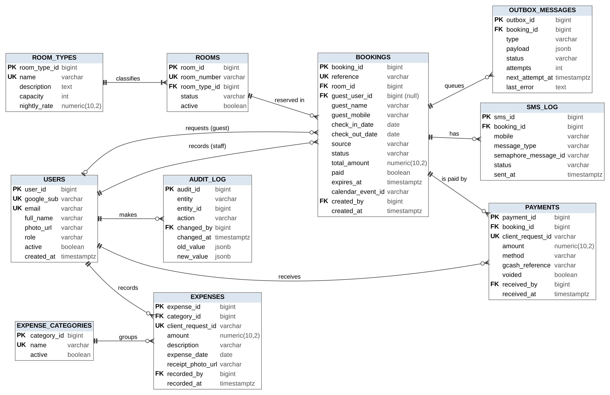

*Figure 1. Entity Relationship Diagram of the AJ Apartelle system (Crow's Foot notation: `||` exactly one, `o|` zero or one, `o<` zero or many, `|<` one or many).*

*Out of date as of v1.3: Figure 1 shows the old primary key names (now `id` in all ten of its tables); does not show `USERS.mobile_number`, `USERS.password_hash` (FR-071), `USERS.updated_at` or the REVOKED_TOKENS table (FR-046); does not show `PAYMENTS.voided_at`, `voided_by`, `void_reason` or the voids relationship from USERS to PAYMENTS (FR-029); does not show `USERS.token_version` or the PASSWORD_RESET_TOKENS table and its relationship to USERS (FR-073 to FR-075); still shows the removed `PAYMENTS.voided`; and does not mark `USERS.google_sub` and `USERS.photo_url` as planned (FR-041). The ERD tables below give the current design; of these, migration V1 creates USERS (without the planned changes) and REVOKED_TOKENS, and migration V2 adds `USERS.token_version` and PASSWORD_RESET_TOKENS.*

**ERD tables (transcribed from Figure 1)**

Key convention: each table's primary key is `id`, and foreign keys are `<table>_id` (for example, `bookings.room_id` and `payments.booking_id`). Exceptions: REVOKED_TOKENS is keyed by `jti` (migration V1), and these foreign keys keep their descriptive names: `bookings.guest_user_id`, `bookings.created_by`, `payments.received_by`, `payments.voided_by`, `expenses.category_id`, `expenses.recorded_by` and `audit_log.changed_by`.

| Table | Columns (key · name · type) |
|---|---|
| ROOM_TYPES | PK id bigint · UK name varchar · description text · capacity int · nightly_rate numeric(10,2) |
| ROOMS | PK id bigint · UK room_number varchar · FK room_type_id bigint · status varchar · active boolean |
| BOOKINGS | PK id bigint · UK reference varchar · FK room_id bigint · FK guest_user_id bigint (null) · guest_name varchar · guest_mobile varchar · check_in_date date · check_out_date date · source varchar · status varchar · total_amount numeric(10,2) · paid boolean · expires_at timestamptz · calendar_event_id varchar · FK created_by bigint · created_at timestamptz |
| PAYMENTS | PK id bigint · FK booking_id bigint · UK client_request_id varchar · amount numeric(10,2) · method varchar · gcash_reference varchar · FK received_by bigint · received_at timestamptz · voided_at timestamptz (null) · FK voided_by bigint (null, references users.id) · void_reason text (null) · CHECK (voided_at IS NULL OR (void_reason IS NOT NULL AND voided_by IS NOT NULL)). A payment is voided when voided_at IS NOT NULL. Payments are never deleted; voids are also written to AUDIT_LOG (FR-029, NFR-08). |
| EXPENSE_CATEGORIES | PK id bigint · UK name varchar · active boolean |
| EXPENSES | PK id bigint · FK category_id bigint · UK client_request_id varchar · amount numeric(10,2) · description varchar · expense_date date · receipt_photo_url varchar · FK recorded_by bigint · recorded_at timestamptz |
| USERS | PK id bigint · UK google_sub varchar (planned, added with FR-041) · UK email varchar · full_name varchar · mobile_number varchar(11) (nullable, format 09XXXXXXXXX) · photo_url varchar (planned, added with FR-041) · password_hash varchar (NOT NULL in V1; becomes nullable for Google-only and pre-added staff accounts in the same future FR-041 migration, with CHECK (role = 'STAFF' OR password_hash IS NOT NULL OR google_sub IS NOT NULL); staff pre-added without a password can sign in only once Google links their account) · role varchar · active boolean · created_at timestamptz · updated_at timestamptz (NOT NULL) · token_version int (NOT NULL DEFAULT 0, migration V2; copied to the JWT claim `tv`, and the authentication filter rejects a token whose `tv` differs; incremented on password change, password reset and deactivation, and later by FR-041 linking) |
| AUDIT_LOG | PK id bigint · entity varchar · entity_id bigint · action varchar · FK changed_by bigint · changed_at timestamptz · old_value jsonb · new_value jsonb |
| OUTBOX_MESSAGES | PK id bigint · FK booking_id bigint · type varchar · payload jsonb · status varchar · attempts int · next_attempt_at timestamptz · last_error text |
| SMS_LOG | PK id bigint · FK booking_id bigint · mobile varchar · message_type varchar · semaphore_message_id varchar · status varchar · sent_at timestamptz |
| REVOKED_TOKENS | PK jti varchar(64) · expires_at timestamptz. Server-side sign-out (FR-046): the id (jti) of a signed-out JWT is stored here and rejected until the token would have expired; expired rows are purged hourly. No foreign keys. |
| PASSWORD_RESET_TOKENS | PK id bigint · FK user_id bigint (NOT NULL, references users.id) · UK token_hash varchar(64) (SHA-256 in hex; the raw token is never stored) · expires_at timestamptz (NOT NULL) · used_at timestamptz (null; set when the token is used or invalidated) · created_at timestamptz (NOT NULL; counted for the hourly limit). Created by migration V2; rows are purged one day after they expire (FR-074, FR-075). |

**Table 6. ERD relationships and cardinalities**

| Entity | Relationship | Entity | Cardinality |
|---|---|---|---|
| ROOM_TYPES | classifies | ROOMS | One room type has one or many rooms; each room has exactly one type (1 to 1..N). |
| ROOMS | is reserved in | BOOKINGS | One room has zero or many bookings; each booking is for exactly one room (1 to 0..N). |
| USERS (guest) | requests | BOOKINGS | A guest user has zero or many bookings; a booking has zero or one guest user, since walk-in and phone guests have no account (0..1 to 0..N). |
| USERS (staff) | records | BOOKINGS | Each booking is created by exactly one user; a user creates zero or many bookings (1 to 0..N). |
| BOOKINGS | is paid by | PAYMENTS | One booking has zero or many payments; each payment belongs to exactly one booking (1 to 0..N). |
| USERS (staff) | receives | PAYMENTS | Each payment is received by exactly one staff user (1 to 0..N). |
| EXPENSE_CATEGORIES | groups | EXPENSES | One category has zero or many expenses; each expense has exactly one category (1 to 0..N). |
| USERS (staff) | records | EXPENSES | Each expense is recorded by exactly one staff user (1 to 0..N). |
| BOOKINGS | queues | OUTBOX_MESSAGES | One booking has zero or many pending calendar and SMS updates (1 to 0..N). |
| BOOKINGS | has | SMS_LOG | One booking has zero or many sent text messages (1 to 0..N). |
| USERS (owner) | voids | PAYMENTS | One owner voids zero or many payments; a payment has zero or one voiding user (0..1 to 0..N). |
| USERS | makes | AUDIT_LOG | One user makes zero or many logged changes (1 to 0..N). |
| USERS | requests | PASSWORD_RESET_TOKENS | One user has zero or many reset tokens; each token belongs to exactly one user (1 to 0..N). |

REVOKED_TOKENS has no relationship to other tables: it is keyed only by the JWT id (jti).

### 5.2. Use Case Models

The use case model has five actors inside or around one system boundary: Guest, Front-desk Staff, Owner, the Scheduler (time), and four external systems (Google OAuth 2.0, Google Calendar API, Semaphore SMS API, Gmail SMTP). The Owner is a specialization (generalization) of Front-desk Staff and can perform every staff use case. For readability the model is shown in two figures with the same system boundary.

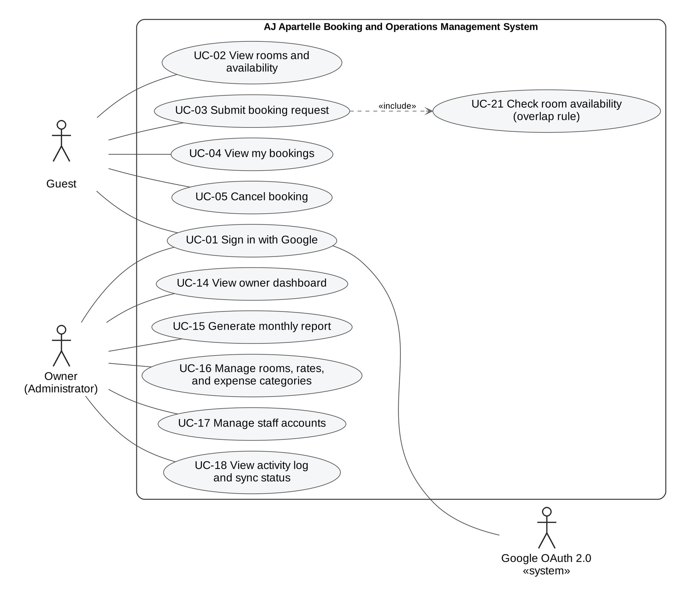

*Figure 2. Use case diagram, part 1: Guest and Owner use cases.*

*Out of date as of v1.3: Figure 2 labels UC-01 "Sign in with Google"; UC-01 also covers email-and-password sign-in (FR-071). It also does not show UC-24, UC-25, UC-26 or Gmail SMTP. Table 7 is current.*

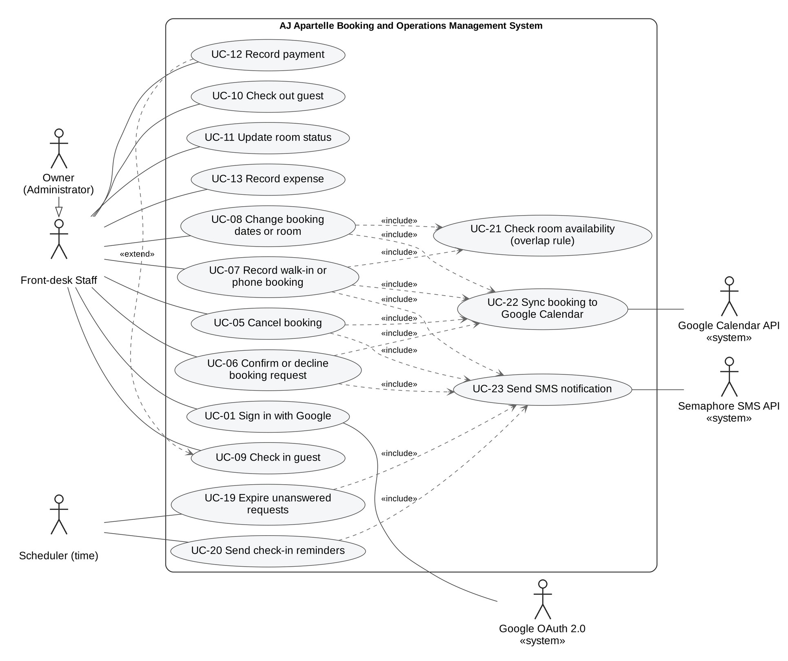

*Figure 3. Use case diagram, part 2: Front-desk Staff and Scheduler use cases with «include» and «extend» relationships; the hollow arrow from Owner to Front-desk Staff is a generalization.*

*Out of date as of v1.3: Figure 3 labels UC-01 "Sign in with Google"; UC-01 also covers email-and-password sign-in (FR-071). It also does not show UC-24, UC-25, UC-26 or Gmail SMTP. Table 7 is current.*

**Table 7. Use case summary and traceability to functional requirements**

| ID | Use case | Actor(s) | Functional requirements |
|---|---|---|---|
| UC-01 | Sign in with Google or with email and password; link Google to an existing account with the same verified email (guest: password cleared and tokens invalidated; staff and owner: password kept; refused if already linked to a different Google account) | Guest, Staff, Owner; Google OAuth 2.0 | FR-041 to FR-046, FR-071 |
| UC-02 | View rooms and availability | Guest | FR-001 to FR-005 |
| UC-03 | Submit booking request | Guest | FR-006 to FR-009, FR-013 |
| UC-04 | View my bookings | Guest | FR-011 |
| UC-05 | Cancel booking | Guest, Staff | FR-012, FR-019 |
| UC-06 | Confirm or decline booking request | Staff | FR-014 to FR-016, FR-020 |
| UC-07 | Record walk-in or phone booking | Staff | FR-017 |
| UC-08 | Change booking dates or room | Staff | FR-018 |
| UC-09 | Check in guest | Staff | FR-021, FR-022, FR-070 |
| UC-10 | Check out guest | Staff | FR-023, FR-024 |
| UC-11 | Update room status | Staff | FR-025, FR-026 |
| UC-12 | Record payment (extends UC-09); alternate flow: the owner voids a payment by giving a reason (FR-029) | Staff; Owner (void) | FR-027 to FR-030, FR-069 |
| UC-13 | Record expense | Staff | FR-031, FR-032, FR-034, FR-069 |
| UC-14 | View owner dashboard | Owner | FR-035, FR-037 |
| UC-15 | Generate monthly report | Owner | FR-036, FR-040 |
| UC-16 | Manage rooms, rates, and expense categories | Owner | FR-033, FR-059, FR-060 |
| UC-17 | Manage staff accounts | Owner | FR-061, FR-062 |
| UC-18 | View activity log and sync status | Owner | FR-038, FR-039, FR-058 |
| UC-19 | Expire unanswered requests | Scheduler (time) | FR-010 |
| UC-20 | Send check-in reminders | Scheduler (time) | FR-055 |
| UC-21 | Check room availability (overlap rule) | Included by UC-03, UC-07, UC-08 | FR-002, FR-009 |
| UC-22 | Sync booking to Google Calendar | Included; Google Calendar API | FR-047 to FR-051 |
| UC-23 | Send SMS notification | Included; Semaphore SMS API | FR-052 to FR-054, FR-056, FR-057 |
| UC-24 | View and edit own profile | Guest, Staff, Owner | FR-072 |
| UC-25 | Change password; alternate flow: a wrong current password or invalid new password is refused and nothing changes | Guest, Staff, Owner | FR-073, FR-045 |
| UC-26 | Reset a forgotten password by emailed link; alternate flows: no email for an unknown or deactivated account or above the hourly limit (same message shown); an invalid, expired, or used link is refused | Guest, Staff, Owner; Gmail SMTP | FR-074, FR-075 |

### 5.3. Activity Diagram

Figure 4 shows the main workflow: a guest's online booking request, the system's overlap check, the staff decision or automatic expiry, the parallel calendar and SMS updates, and the stay through check-out. Figure 5 shows the front-desk staff's guided daily workflow.

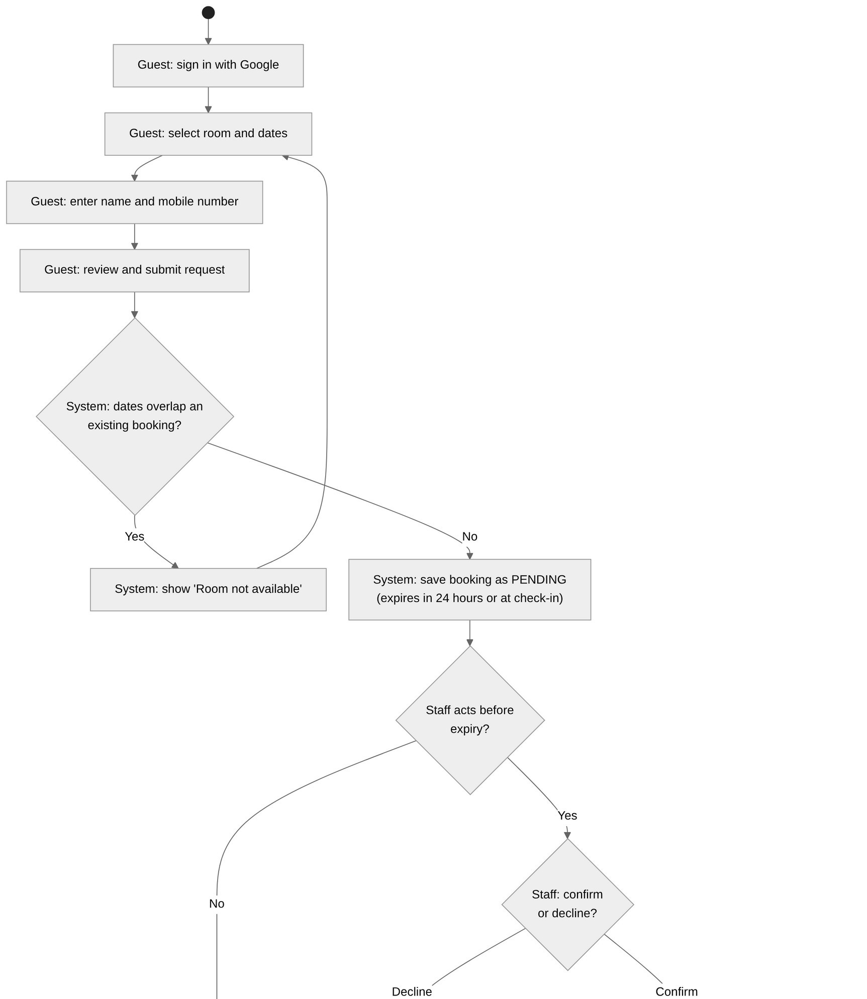

*Figure 4. Activity diagram: online booking request to check-out (part 1 of 2).*

*Out of date as of v1.3: the first step in Figure 4 shows only Google sign-in; the guest may also sign in with email and password (FR-071).*

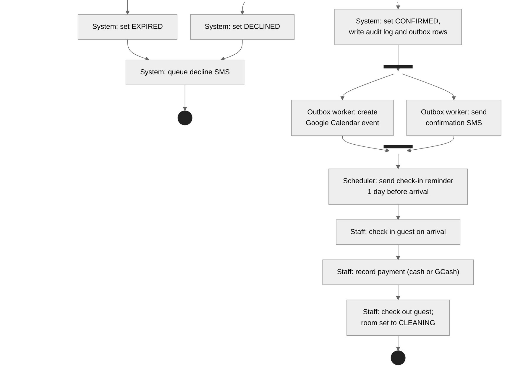

*Figure 4 (continued). Activity diagram: online booking request to check-out (part 2 of 2).*

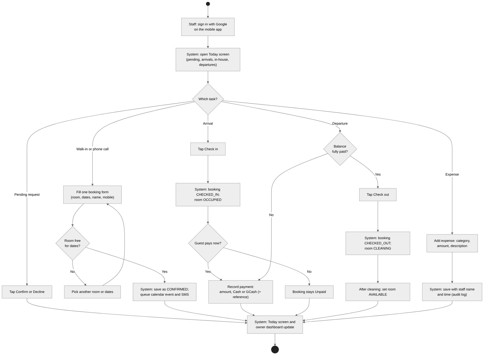

*Figure 5. Activity diagram: front-desk staff guided daily workflow.*

*Out of date as of v1.3: the first step in Figure 5 shows only Google sign-in; staff may also sign in with email and password (FR-071).*

### 5.4. Class Diagram

Figure 6 shows the main domain classes (entities stored in the database), their enumerations, and the service and integration classes of the backend. Composition links a Booking to its Payments; dependencies show which services create, process, or use other classes.

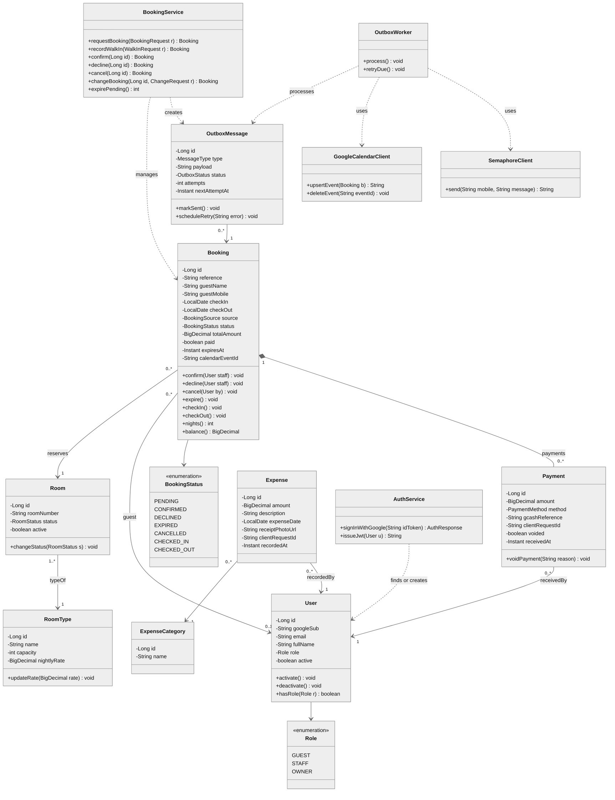

*Figure 6. Class diagram of the AJ Apartelle backend.*

*Out of date as of v1.3: Figure 6 shows only Google sign-in in AuthService and no password hash in User; FR-071 adds both email-and-password sign-in and the hash. Payment also lacks the void fields and still shows the removed `voided` attribute (FR-029). It also does not show the token version, the reset token, or the profile and password services (FR-072 to FR-075).*

### 5.5. Sequence Diagram

Figure 7 shows how a guest's booking request is saved or rejected, how staff confirmation commits the booking and the outbox records in one transaction, and how the outbox worker then calls Google Calendar and Semaphore, retrying on failure. Figure 8 shows Google sign-in and role assignment.

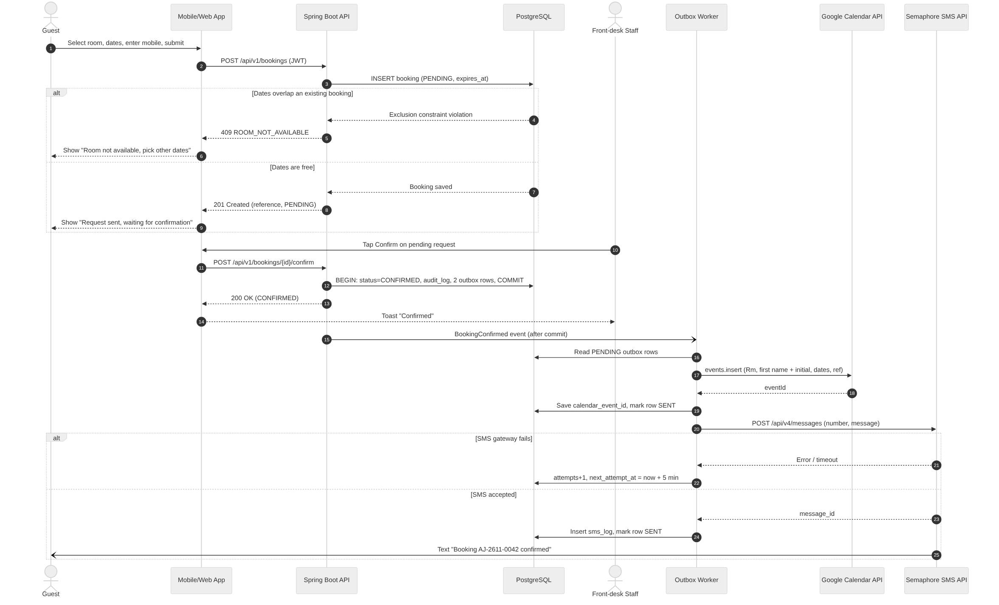

*Figure 7. Sequence diagram: booking request, staff confirmation, calendar sync, and SMS confirmation.*

Key points from Figure 7: an overlap returns `409 ROOM_NOT_AVAILABLE` from the exclusion-constraint violation; a free slot returns `201 Created (reference, PENDING)`. Confirm runs one transaction (`status=CONFIRMED`, audit_log row, 2 outbox rows, COMMIT), then a `BookingConfirmed` event after commit wakes the outbox worker. The worker calls `events.insert`, saves `calendar_event_id`, then `POST /api/v4/messages` to Semaphore; on error it sets `attempts+1, next_attempt_at = now + 5 min`; on success it inserts `sms_log` and marks the row SENT.

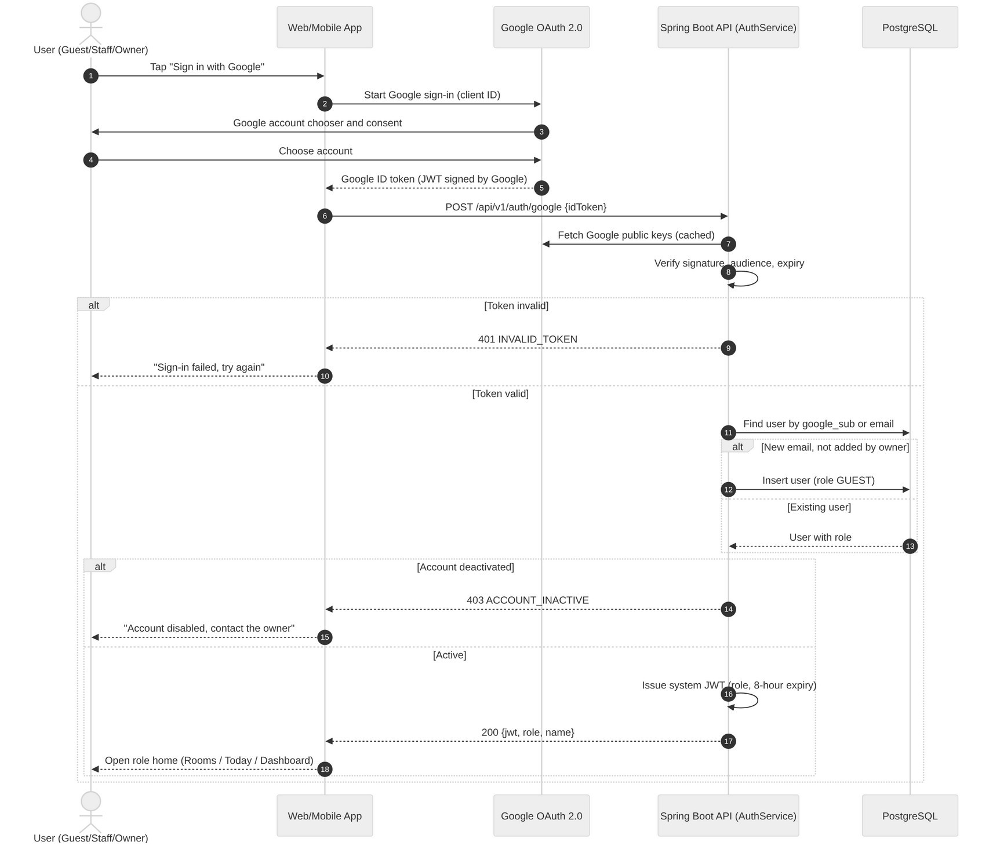

*Figure 8. Sequence diagram: sign in with Google OAuth 2.0 and role-based session.*

*Out of date as of v1.3: step 17 of Figure 8 returns the JWT in the response body to both apps; on the web it is set only in a cookie (NFR-07). The key points below are current. Steps 11 to 13 also omit the verified-email check, account linking, the guest password and token reset, and the 409 for a different `google_sub` (FR-041). Figure 8 covers Google sign-in only, not FR-071.*

Key points from Figure 8: the client posts the Google ID token to `POST /api/v1/auth/google`; the backend verifies signature, audience, and expiry against Google's cached public keys (`401 INVALID_TOKEN` on failure), finds the user by `google_sub`, otherwise by email (for an existing account it links `google_sub` and keeps the role, only if Google reports the email as verified: for a self-registered GUEST it also sets `password_hash` to NULL and increments `token_version` to invalidate all existing tokens, while STAFF and OWNER keep their password; if the account already has a different `google_sub`, it returns `409` and changes nothing; if the email is not verified, it neither links nor signs in to that account; with no matching account it inserts a new GUEST), returns `403 ACCOUNT_INACTIVE` for deactivated accounts, otherwise issues the system JWT (role, 8-hour expiry). On the web it returns `200 {role, name}` and sets the JWT only in the httpOnly `AJ_TOKEN` cookie (NFR-07); for the planned mobile app it returns `200 {jwt, role, name}`, and the app keeps the token in Expo SecureStore.

---

## 6. Initial Project Timeline

Development runs for four weeks. The plan follows the build order of the system: base setup, sign-in, and setup data first, then the booking core, then the integrations, which are tested against real bookings. Because the schedule is short, all Must Have requirements are built first; Should Have and Could Have requirements are added only if time remains, as the MoSCoW priorities intend.

**Table 8. Initial project timeline**

| Week | Planned activity |
|---|---|
| Week 1 | **Foundation, sign-in, and setup.** Spring Boot project, PostgreSQL schema with Flyway (all tables and the overlap constraint), Swagger UI, GitHub repository with the GitHub Actions CI pipeline (NFR-26); apply for the Semaphore sender name on day 1. Google Cloud project, OAuth clients, Google sign-in on web and mobile, JWT and role-based access (Feature 8). Owner setup of rooms, room types, rates, staff accounts, and expense categories (Feature 11); room listing and availability (Feature 1). Figma prototype of the main screens. |
| Week 2 | **Booking core and staff workflow.** Online booking requests with the overlap rule and automatic expiry; confirm, decline, walk-in, change, and cancel (Features 2 and 3). Staff Today screen, check-in, check-out, room status, payment and expense recording, audit log (Features 4, 5, 6). |
| Week 3 | **Integrations and owner dashboard.** Booking events, outbox table, worker, and retry job; Google Calendar synchronization (Feature 9); Semaphore SMS confirmations, decline and cancellation notices, and check-in reminders (Feature 10). Owner dashboard, monthly summary, activity log, and sync status (Feature 7). |
| Week 4 | **Testing and delivery.** Test every Must Have requirement and the NFRs; usability test with front-desk staff; bug fixing; Should Have items if time allows (including the offline queue, FR-069 and FR-070); Android APK build and deployment; final documentation and project presentation. |

---

## 7. References

- Agile Business Consortium. (n.d.). *MoSCoW prioritisation*. https://www.agilebusiness.org/dsdm-project-framework/moscow-prioritisation.html
- College of Computer Studies, Cebu Institute of Technology – University. (2026). *Overview of system integration* [Lecture slides]. IT342 Systems Integration and Architecture 1.
- College of Computer Studies, Cebu Institute of Technology – University. (2026). *Requirement engineering and analysis* [Lecture slides]. IT342 Systems Integration and Architecture 1.
- Google. (n.d.). *Google Calendar API overview*. Google for Developers. https://developers.google.com/calendar/api/guides/overview
- Google. (n.d.). *Using OAuth 2.0 to access Google APIs*. Google for Developers. https://developers.google.com/identity/protocols/oauth2
- Google. (n.d.). *Verify the Google ID token on your server side*. Google for Developers. https://developers.google.com/identity/gsi/web/guides/verify-google-id-token
- ISO/IEC/IEEE. (2018). *Systems and software engineering — Life cycle processes — Requirements engineering* (ISO/IEC/IEEE Standard No. 29148:2018).
- Meta Platforms. (n.d.). *React*. https://react.dev/
- Meta Platforms. (n.d.). *React Native*. https://reactnative.dev/
- National Privacy Commission. (2012). *Republic Act No. 10173: Data Privacy Act of 2012*. https://privacy.gov.ph/data-privacy-act/
- Object Management Group. (2017). *OMG Unified Modeling Language (UML), Version 2.5.1*. https://www.omg.org/spec/UML/2.5.1
- PostgreSQL Global Development Group. (n.d.). *Constraints: Exclusion constraints*. PostgreSQL documentation. https://www.postgresql.org/docs/current/ddl-constraints.html
- Richardson, C. (n.d.). *Pattern: Transactional outbox*. Microservices.io. https://microservices.io/patterns/data/transactional-outbox.html
- Semaphore. (n.d.). *API documentation*. https://api.semaphore.co/docs
- Semaphore. (n.d.). *Frequently asked questions*. https://api.semaphore.co/faq
- Spring. (n.d.). *Spring Boot reference documentation*. https://docs.spring.io/spring-boot/index.html

---

## 8. Appendices

### 8.1. Appendix A: Glossary and Definitions

| Term | Definition |
|---|---|
| Apartelle | A building offering furnished rooms for short or extended stays, combining features of an apartment and a hotel. |
| Booking reference | Unique code given to each booking, in the format AJ-YYMM-NNNN (for example, AJ-2611-0042). |
| PENDING | An online booking request waiting for staff to confirm or decline it; it holds the room and dates. |
| CONFIRMED | A booking accepted by staff, or a walk-in or phone booking recorded by staff. Only confirmed bookings are sent to the calendar and trigger the confirmation SMS. |
| Real-time availability | Availability that includes every pending and confirmed booking recorded up to the moment the page or screen loads; the overlap check runs again on submission. |
| Step (guest booking) | One screen the guest completes before moving to the next; counting starts after sign-in (Google or email and password). |
| Action (staff workflow) | One tap or click, such as opening a record, choosing an option, or pressing Save or Confirm; typing into the fields of one form counts as part of that form's action. |
| Within one minute | Measured from the moment the change is saved in the database. |
| Offline queue | On-device list in the staff app holding payment and expense entries made without internet; they are sent automatically, once each, when the connection returns. |
| Outbox | A database table holding calendar and SMS updates that must be sent; a worker sends them and retries failures, so external outages never lose a booking. |
| JWT | JSON Web Token: the signed token the backend issues after sign-in (Google or email and password) and checks on every request. |
| MoSCoW | Prioritization method: Must Have, Should Have, Could Have, Won't Have. |
| RA 10173 | Republic Act No. 10173, the Data Privacy Act of 2012 of the Philippines. |

### 8.2. Appendix B: System Architecture Diagram

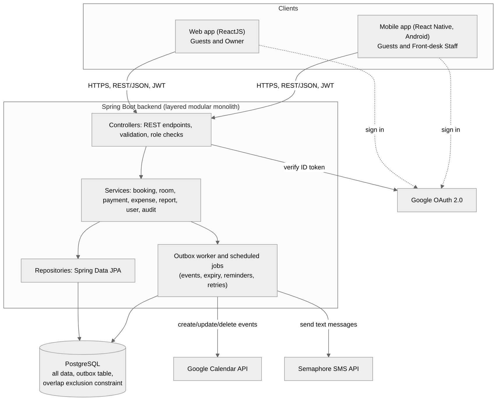

*Figure 9. System architecture: client-server, layered backend, event-driven integrations.*

*Out of date as of v1.3: Figure 9 shows only Google sign-in; the apps may also sign in to the backend with email and password (FR-071), and the backend also sends password reset emails through Gmail SMTP (FR-074). The summary below is current.*

Summary: Web app (ReactJS; guests and owner) and Mobile app (React Native, Android; guests and front-desk staff) call the Spring Boot backend (layered modular monolith) over HTTPS REST/JSON with JWT, and sign in with Google OAuth 2.0 or with an email address and password (FR-071). Backend layers: Controllers (REST endpoints, validation, role checks) → Services (booking, room, payment, expense, report, user, audit) → Repositories (Spring Data JPA) → PostgreSQL (all data, outbox table, overlap exclusion constraint). An Outbox worker and scheduled jobs (events, expiry, reminders, retries) create/update/delete Google Calendar events and send Semaphore SMS. Password reset emails go to Gmail SMTP from a background task after commit (D-08).

### 8.3. Appendix C: Booking Status Lifecycle

A booking moves through these statuses. Only CONFIRMED creates a calendar event and a confirmation SMS; EXPIRED and DECLINED send a decline SMS; CANCELLED deletes the calendar event and sends a cancellation SMS.

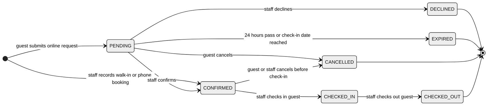

*Figure 10. State diagram of booking statuses.*

| From | Trigger | To |
|---|---|---|
| (start) | Guest submits online request | PENDING |
| (start) | Staff records walk-in or phone booking | CONFIRMED |
| PENDING | Staff confirms | CONFIRMED |
| PENDING | Staff declines | DECLINED (end) |
| PENDING | 24 hours pass or check-in date reached | EXPIRED (end) |
| PENDING | Guest cancels | CANCELLED (end) |
| CONFIRMED | Guest or staff cancels before check-in | CANCELLED (end) |
| CONFIRMED | Staff checks in guest | CHECKED_IN |
| CHECKED_IN | Staff checks out guest | CHECKED_OUT (end) |

### 8.4. Appendix D: Requirements Traceability Matrix

| Specific objective | Features | Functional requirements | Use cases | Main tables |
|---|---|---|---|---|
| SO1 Guest booking module (3 steps, overlap rejection) | Features 1, 2 | FR-001 to FR-013 | UC-02, UC-03, UC-04, UC-05, UC-19, UC-21 | BOOKINGS, ROOMS, ROOM_TYPES |
| SO2 Guided staff workflow (3 actions) | Features 3, 4, 5, 6 | FR-014 to FR-034, FR-069, FR-070 | UC-05 to UC-13 | BOOKINGS, PAYMENTS, EXPENSES, EXPENSE_CATEGORIES, AUDIT_LOG |
| SO3 Owner dashboard and monthly report | Feature 7 | FR-035 to FR-040 | UC-14, UC-15, UC-18 | PAYMENTS, EXPENSES, BOOKINGS, AUDIT_LOG, OUTBOX_MESSAGES |
| SO4 Google OAuth 2.0 and role-based access | Features 8, 11 | FR-041 to FR-046, FR-059 to FR-062, FR-071 to FR-075 | UC-01, UC-16, UC-17, UC-24 to UC-26 | USERS, REVOKED_TOKENS, PASSWORD_RESET_TOKENS, ROOMS, ROOM_TYPES |
| SO5 Google Calendar sync within 1 minute | Feature 9 | FR-047 to FR-051 | UC-22 | BOOKINGS, OUTBOX_MESSAGES |
| SO6 Semaphore SMS within 1 minute; reminder 1 day before | Feature 10 | FR-052 to FR-058 | UC-20, UC-23 | OUTBOX_MESSAGES, SMS_LOG |

### 8.5. Appendix E: REST API Endpoint Summary

All paths start with `/api/v1` and exchange JSON. Except the endpoints marked Public below, every call needs the system JWT. Web requests carry it in the httpOnly `AJ_TOKEN` cookie (current behavior, NFR-07); the planned mobile app will send it as `Authorization: Bearer <token>`. Errors use one format `{"code", "message"}`, plus `fieldErrors` for invalid fields, with HTTP 400, 401, 403, 404, or 409 (a conflict, such as an overlapping booking or a different linked Google account); a wrong method, wrong content type, or unexpected failure uses the same format with 405, 415, or 500.

| Method | Path | Who | Purpose |
|---|---|---|---|
| POST | `/auth/google` | Public | Exchange a Google ID token for the system JWT and role; link an existing account with the same verified email (GUEST: clear password and invalidate tokens; STAFF, OWNER: keep password; 409 if linked to a different google_sub) (FR-041) |
| POST | `/auth/register` | Public | Create a GUEST account with email and password (FR-071) |
| POST | `/auth/login`, `/auth/logout` | Public | Email-and-password sign-in (FR-071); sign out (FR-046) |
| GET | `/auth/me` | Any signed-in user | Current user and role |
| POST | `/auth/forgot-password` | Public | Request a reset link; body `{email}`; always the same 200 message (FR-074) |
| POST | `/auth/reset-password` | Public | Set a new password; body `{token, newPassword, confirmPassword}` (FR-075) |
| GET, PUT | `/me/profile` | Any signed-in user (own) | View own profile; edit with body `{fullName, mobileNumber}` (FR-072) |
| POST | `/me/password` | Any signed-in user (own) | Change password; body `{currentPassword, newPassword, confirmPassword}`; renews the session cookie (FR-073) |
| GET | `/rooms`, `/rooms/availability` | Public | Room list; rooms free for given dates |
| GET | `/rooms/{id}/calendar` | Public | Booked dates of one room for a month |
| POST | `/bookings` | Guest | Submit a booking request (PENDING) |
| GET | `/bookings/mine` | Guest | Guest's own bookings |
| POST | `/bookings/{id}/cancel` | Guest (own), Staff | Cancel before the check-in date |
| GET | `/staff/today` | Staff | Pending, arrivals, in-house, departures |
| POST | `/bookings/{id}/confirm`, `/decline` | Staff | Confirm or decline a pending request |
| POST | `/bookings/walk-in` | Staff | Record a walk-in or phone booking (CONFIRMED) |
| PATCH | `/bookings/{id}` | Staff | Change dates or room |
| POST | `/bookings/{id}/check-in`, `/check-out` | Staff | Check in or check out |
| PATCH | `/rooms/{id}/status` | Staff | Set AVAILABLE, OCCUPIED, or CLEANING |
| POST | `/bookings/{id}/payments` | Staff | Record a cash or GCash payment |
| POST, GET | `/expenses` | Staff, Owner | Record and list expenses |
| GET | `/owner/dashboard`, `/owner/reports/monthly` | Owner | Dashboard figures and monthly summary |
| POST, PUT | `/owner/rooms`, `/owner/room-types`, `/owner/expense-categories` | Owner | Manage rooms, rates, and categories |
| GET, POST, PATCH | `/owner/staff` | Owner | Add, activate, or deactivate staff |
| POST | `/owner/payments/{id}/void` | Owner | Void a payment; body `{reason}` (FR-029) |
| GET | `/owner/audit`, `/owner/outbox` | Owner | Activity log and sync status |

**Open items**

- The backend authentication filter currently reads the JWT only from the `AJ_TOKEN` cookie. It must also accept the `Authorization: Bearer <token>` header when the mobile app is built (NFR-07).

### 8.6. Appendix F: Role Permission Matrix

| Capability | Guest | Staff | Owner |
|---|---|---|---|
| View rooms and availability | Yes | Yes | Yes |
| View and edit own profile; change or reset own password | Yes | Yes | Yes |
| Submit, view, and cancel own bookings | Yes | No | No |
| Confirm, decline, walk-in, change, cancel any booking | No | Yes | Yes |
| Check-in, check-out, room status | No | Yes | Yes |
| Record payments and expenses | No | Yes | Yes |
| Void payments; manage expense categories | No | No | Yes |
| Dashboard, monthly reports, activity log, sync status | No | No | Yes |
| Manage rooms, rates, and staff accounts | No | No | Yes |

### 8.7. Appendix G: SMS Message Templates

Each message stays within 160 characters so it uses one Semaphore credit. Messages never begin with the word "test", which Semaphore silently drops.

| Message | Text |
|---|---|
| Confirmation | AJ Apartelle: Booking AJ-2611-0042 confirmed. Rm 203, Nov 26-28. Pay at front desk on arrival. |
| Decline / expired | AJ Apartelle: Sorry, we can't accept booking AJ-2611-0042 for Nov 26-28. Please try other dates on our site. |
| Check-in reminder | AJ Apartelle: Reminder, check-in tomorrow Nov 26, Rm 203. Booking AJ-2611-0042. See you! |
| Cancellation | AJ Apartelle: Booking AJ-2611-0042 for Nov 26-28 has been cancelled. |
